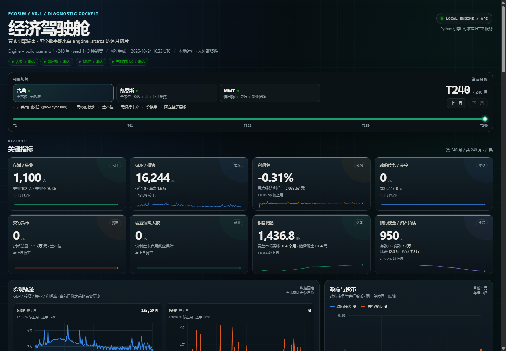
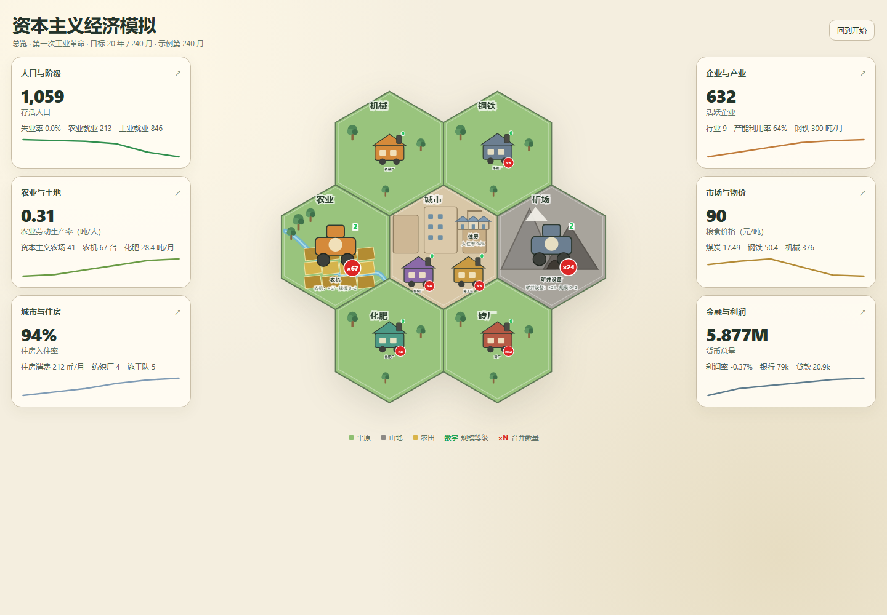
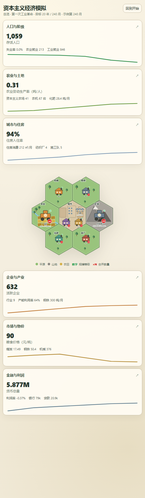
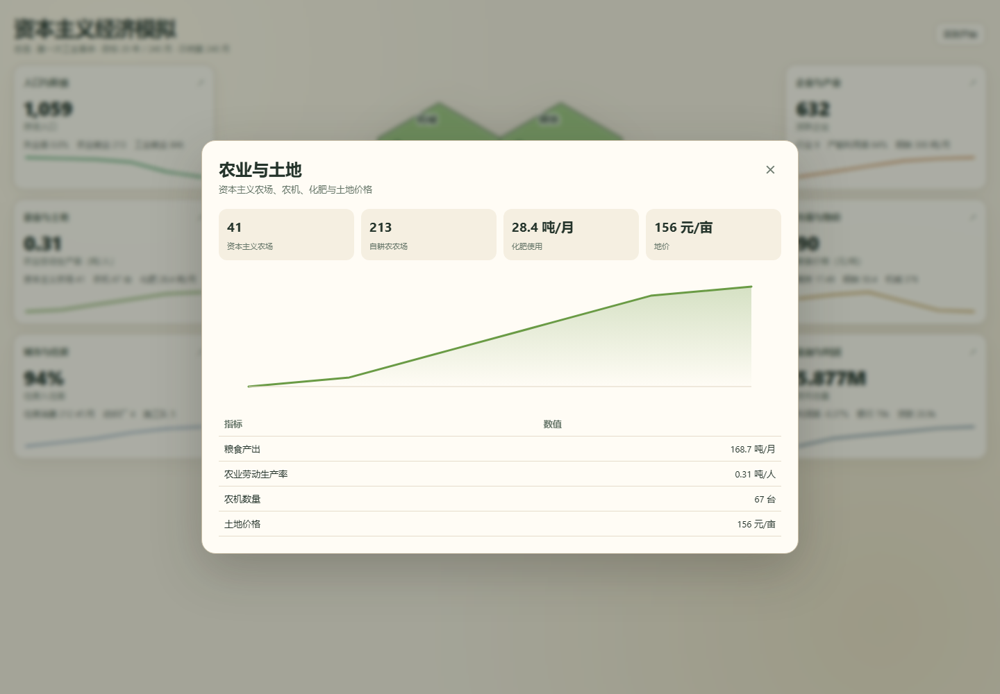

# HTML 发行版（原型阶段）

最终发行版只包含一个 HTML 文件：用户下载后在电脑上双击打开，或在手机上用指定浏览器打开，
即可游玩，不要求安装 Python，也不依赖服务器或外部资源。

当前状态：**UI 视觉原型已存在**（ui-preview.html，另有较早的 hex-map-preview.html），但尚未接入仿真引擎。它使用内联 SVG/JS，可直接双击打开。技术路线与理由见 [[docs/decisions/0003-html-release.md]]。

## V0.4 本地驾驶舱（当前推荐用于找 BUG）

前后端分离：Python 标准库 HTTP 服务 + 原生 HTML/JS/SVG，数据来自真实
`Engine.stats`，不把 240 月数据嵌进 HTML。

```powershell
python scripts/serve_dashboard.py --port 8765
# 浏览器打开 http://127.0.0.1:8765
```



支持制度切换、月份时间轴、宏观/政府/商品/行业图表、利润分解、银行/政府预算/
库存/价格带诊断、三制度对比。旧的 `ui-preview.html` 是 V0.3.2 硬编码原型，
保留作视觉参考；最终单文件 HTML 发行版尚未同步 V0.4。

计划结构：

```
web/
├─ src/
│  ├─ engine.ts      # 经济内核，与 Python 参考实现保持逻辑一致
│  ├─ ui.ts          # 界面、图表、交互
│  └─ styles.css
├─ build.mjs         # 把 TS/CSS/默认场景内联进单个 HTML
├─ ui-preview.html       # 完整 UI 原型（开始/总览/详情/地图）
├─ hex-map-preview.html  # 较早的纯地图原型
├─ index.html        # 最终发行文件（构建产物）
└─ golden/           # Python 导出的固定随机种子黄金运行样例
```

构建目标：

1. 一个自包含的 `index.html`，不引用本地文件或 CDN；
2. 打开即进入开始界面，可选择剧本和参数；
3. 游戏内显示人口、阶级、物价、产量、利润率、农业劳动生产率等图表；
4. 与 Python 参考实现共享逻辑定义，用 `golden/` 样例做交叉验证。

在 HTML 版本落地前，经济规则以 `src/ecosim/` 和 `tests/` 为准。
## 当前原型

- ui-preview.html：完整 UI 原型（开始界面、总览、领域详情、六边形地图）；
- hex-map-preview.html：较早的纯地图原型；
- screenshots/：桌面、竖屏、开始界面与详情页截图。

打开方式：直接双击 ui-preview.html，或用 ?view=overview 跳过开始界面、用 ?detail=agriculture 直接打开详情。

## 截图

### 桌面总览



### 竖屏总览



### 开始界面


### 农业详情


